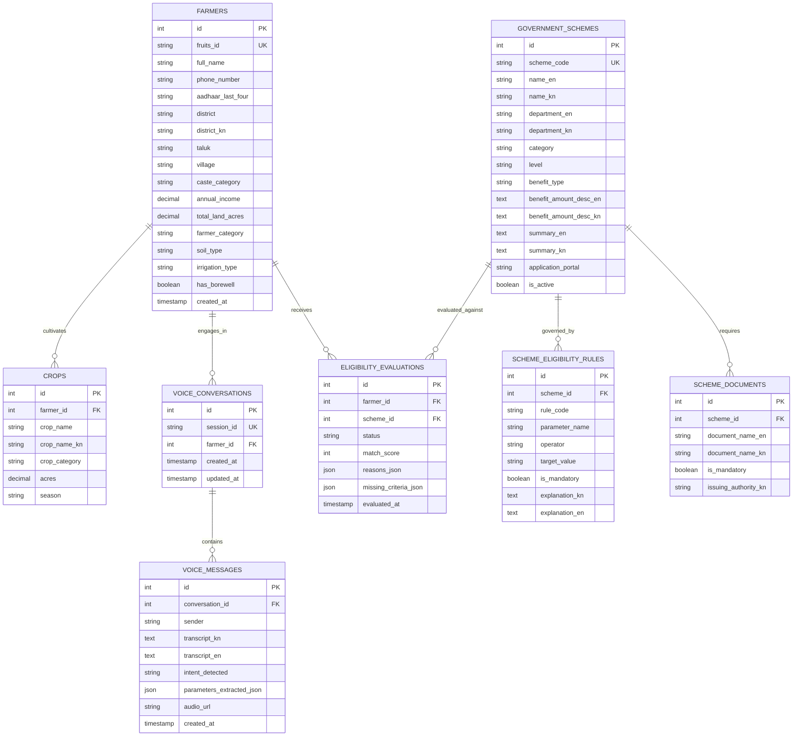

# Krishi Mitra - Database Architecture & Design

## 1. Overview
Krishi Mitra employs **MySQL 8.0** running locally on default port **3306**.
* **Database Name:** `krishi_mitra_db`
* **Character Set:** `utf8mb4`
* **Collation:** `utf8mb4_unicode_ci`
*(Note: `utf8mb4` is mandatory to store Kannada Unicode characters and agricultural terminology accurately without collation corruption).*

---

## 2. Entity-Relationship (ER) Architecture

---

## 3. Detailed Table Schema Definitions

### 3.1 `farmers`
Stores registered farmer demographic, geographic, and agricultural holding profiles.

| Column | Type | Constraints | Description |
|---|---|---|---|
| `id` | INT | PRIMARY KEY, AUTO_INCREMENT | Unique identifier |
| `fruits_id` | VARCHAR(64) | UNIQUE, NULLABLE | Karnataka FRUITS Portal Farmer ID (e.g. `KA-2024-FR-98214`) |
| `full_name` | VARCHAR(150) | NOT NULL | Farmer name in Kannada / English |
| `phone_number` | VARCHAR(15) | INDEX | Mobile phone contact |
| `aadhaar_last_four` | VARCHAR(4) | NULLABLE | Aadhaar last 4 digits for identity lookup |
| `district` | VARCHAR(100) | NOT NULL | District in English (e.g., Mandya, Dharwad) |
| `district_kn` | VARCHAR(100) | NOT NULL | District in Kannada (e.g., ಮಂಡ್ಯ, ಧಾರವಾಡ) |
| `taluk` | VARCHAR(100) | NULLABLE | Taluk name |
| `village` | VARCHAR(100) | NULLABLE | Village name |
| `caste_category` | ENUM | NOT NULL | `'SC'`, `'ST'`, `'OBC'`, `'General'` |
| `annual_income` | DECIMAL(12,2)| NOT NULL DEFAULT 0.00 | Total household annual income |
| `total_land_acres` | DECIMAL(6,2) | NOT NULL | Cumulative landholding in acres |
| `farmer_category` | ENUM | NOT NULL | `'Marginal'` (<2.47 ac), `'Small'` (2.47-4.94 ac), `'Medium'` (4.94-24.7 ac), `'Large'` (>24.7 ac) |
| `soil_type` | VARCHAR(60) | NULLABLE | Red Loamy, Black Cotton, Laterite, etc. |
| `irrigation_type` | VARCHAR(60) | NOT NULL DEFAULT 'Rainfed' | Rainfed (ಮಳೆಯಾಶ್ರಿತ), Canal (ಕಾಲುವೆ), Borewell (ಬೋರ್‌ವೆಲ್), Drip (ಹನಿ ನೀರಾವರಿ) |
| `has_borewell` | BOOLEAN | NOT NULL DEFAULT FALSE | Existing borewell availability |
| `created_at` | TIMESTAMP | DEFAULT CURRENT_TIMESTAMP | Record creation timestamp |
| `updated_at` | TIMESTAMP | ON UPDATE CURRENT_TIMESTAMP | Last update timestamp |

---

### 3.2 `crops`
Stores current and past seasonal crop cultivations per farmer.

| Column | Type | Constraints | Description |
|---|---|---|---|
| `id` | INT | PRIMARY KEY, AUTO_INCREMENT | Unique identifier |
| `farmer_id` | INT | FOREIGN KEY (`farmers.id`) ON DELETE CASCADE | Owner farmer |
| `crop_name` | VARCHAR(100) | NOT NULL | Crop name in English (e.g., Ragi, Paddy, Cotton) |
| `crop_name_kn` | VARCHAR(100) | NOT NULL | Crop name in Kannada (ರಾಗಿ, ಭತ್ತ, ಹತ್ತಿ) |
| `crop_category` | ENUM | NOT NULL | `'Siridhanya_Millet'`, `'Cereal'`, `'Pulse'`, `'Oilseed'`, `'Cash_Crop'`, `'Horticulture'` |
| `acres` | DECIMAL(6,2) | NOT NULL | Land acreage devoted to this crop |
| `season` | ENUM | NOT NULL | `'Kharif'`, `'Rabi'`, `'Summer'`, `'Annual'` |
| `created_at` | TIMESTAMP | DEFAULT CURRENT_TIMESTAMP | Record timestamp |

---

### 3.3 `government_schemes`
The statutory catalog of verified Karnataka and Central agricultural welfare schemes.

| Column | Type | Constraints | Description |
|---|---|---|---|
| `id` | INT | PRIMARY KEY, AUTO_INCREMENT | Unique identifier |
| `scheme_code` | VARCHAR(50) | UNIQUE, NOT NULL | Standard code (e.g., `KA-AGRI-RS-01`) |
| `name_en` | VARCHAR(200) | NOT NULL | Official name in English |
| `name_kn` | VARCHAR(200) | NOT NULL | Official name in Kannada |
| `department_en` | VARCHAR(200) | NOT NULL | Administering ministry / department |
| `department_kn` | VARCHAR(200) | NOT NULL | Department in Kannada |
| `category` | VARCHAR(100) | NOT NULL | Category (Direct Benefit, Irrigation, Subsidy, etc.) |
| `level` | ENUM | NOT NULL | `'Karnataka_State'`, `'Central_Government'` |
| `benefit_type` | ENUM | NOT NULL | `'Direct_Benefit_Transfer'`, `'Subsidy_Capital'`, `'Credit_Interest_Subvention'`, `'Insurance'`, `'Input_Subsidy'` |
| `benefit_amount_desc_en`| TEXT | NOT NULL | Financial subsidy summary in English |
| `benefit_amount_desc_kn`| TEXT | NOT NULL | Financial subsidy summary in Kannada |
| `summary_en` | TEXT | NOT NULL | Detailed English description |
| `summary_kn` | TEXT | NOT NULL | Detailed Kannada description |
| `application_portal` | VARCHAR(255) | NULLABLE | Official URL (e.g., `https://fruits.karnataka.gov.in`) |
| `is_active` | BOOLEAN | DEFAULT TRUE | Availability status flag |

---

### 3.4 `scheme_eligibility_rules`
Deterministic parameter rules that feed the eligibility calculation engine.

| Column | Type | Constraints | Description |
|---|---|---|---|
| `id` | INT | PRIMARY KEY, AUTO_INCREMENT | Unique rule ID |
| `scheme_id` | INT | FOREIGN KEY (`government_schemes.id`) ON DELETE CASCADE | Associated scheme |
| `rule_code` | VARCHAR(60) | NOT NULL | Identifier (e.g., `RULE_MAX_LAND_5ACRES`) |
| `parameter_name` | VARCHAR(60) | NOT NULL | `max_land_acres`, `min_land_acres`, `allowed_caste`, `required_crop_category`, `irrigation_type`, `max_annual_income` |
| `operator` | ENUM | NOT NULL | `'='`, `'!='`, `'<'`, `'<='`, `'>'`, `'>='`, `'IN'`, `'CONTAINS'` |
| `target_value` | VARCHAR(255) | NOT NULL | Value or JSON array to test against |
| `is_mandatory` | BOOLEAN | DEFAULT TRUE | Mandatory qualification flag |
| `explanation_kn`| TEXT | NOT NULL | Plain Kannada reason shown to farmer |
| `explanation_en`| TEXT | NOT NULL | English explanation |

---

### 3.5 `scheme_documents`
Checklists of verified documentation required for scheme sanction.

| Column | Type | Constraints | Description |
|---|---|---|---|
| `id` | INT | PRIMARY KEY, AUTO_INCREMENT | Document rule ID |
| `scheme_id` | INT | FOREIGN KEY (`government_schemes.id`) ON DELETE CASCADE | Associated scheme |
| `document_name_en` | VARCHAR(150) | NOT NULL | Document name in English |
| `document_name_kn` | VARCHAR(150) | NOT NULL | Document name in Kannada (e.g. ಪಹಣಿ/RTC, ಜಾತಿ ಪ್ರಮಾಣಪತ್ರ) |
| `is_mandatory` | BOOLEAN | DEFAULT TRUE | Mandatory upload/submission |
| `issuing_authority_kn` | VARCHAR(150) | NULLABLE | E.g. ಕಂದಾಯ ಇಲಾಖೆ (Revenue Dept) |

---

### 3.6 `voice_conversations` & `voice_messages`
Persists voice sessions and structured conversation logs for auditability and session resumption.

| Table | Key Columns | Purpose |
|---|---|---|
| `voice_conversations` | `id`, `session_id`, `farmer_id`, `created_at` | Tracks multi-turn dialogue session life-cycle |
| `voice_messages` | `id`, `conversation_id`, `sender` (`user`/`assistant`), `transcript_kn`, `intent_detected`, `parameters_extracted_json`, `audio_url` | Full transcript and extracted slot audit log |

---

### 3.7 `eligibility_evaluations`
Audit cache of evaluations performed by the rule engine.

| Column | Type | Description |
|---|---|---|
| `id` | INT | Evaluation ID |
| `farmer_id` | INT | Evaluated farmer |
| `scheme_id` | INT | Evaluated scheme |
| `status` | ENUM | `'ELIGIBLE'`, `'PARTIALLY_ELIGIBLE'`, `'INELIGIBLE'` |
| `match_score` | INT | 0 - 100 percentage |
| `reasons_json` | JSON | Exact rules satisfied |
| `missing_criteria_json` | JSON | Specific rules unsatisfied |
| `evaluated_at` | TIMESTAMP | Execution timestamp |
