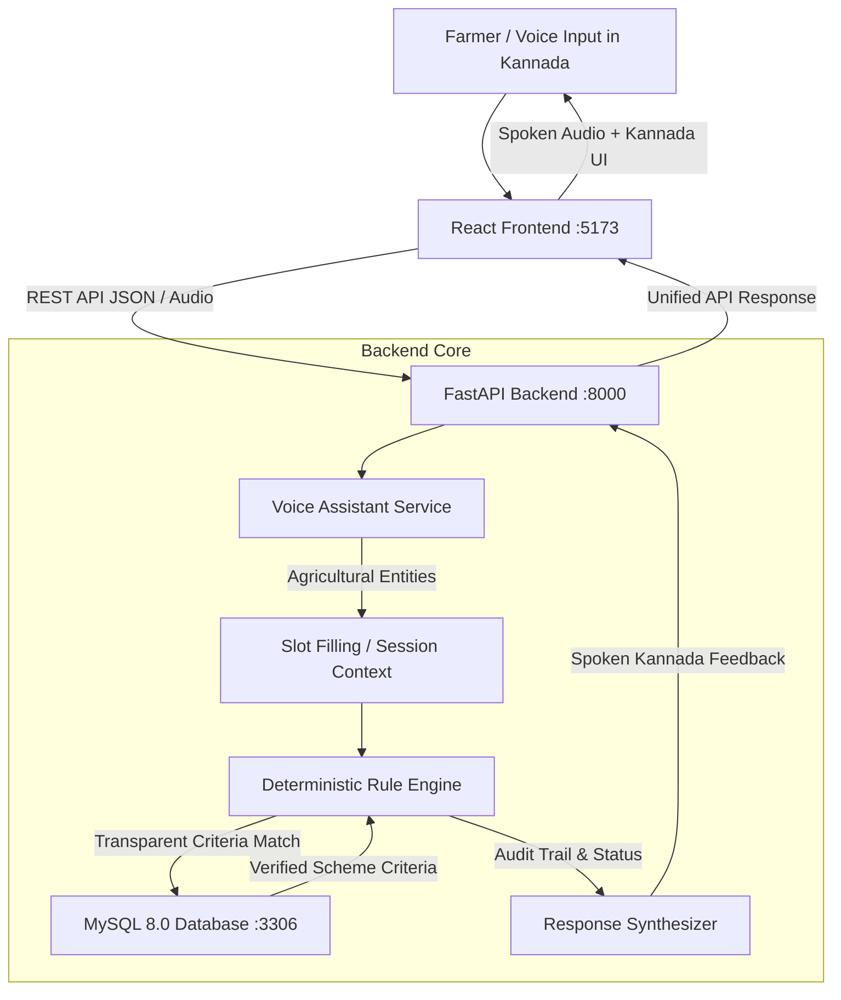

# Krishi Mitra - System Architecture

## System Components
1. **Frontend (Port 5173):** React + Vite + Tailwind CSS with responsive voice controls, real-time audio animation, and Kannada typography.
2. **Backend (Port 8000):** FastAPI server exposing asynchronous REST APIs, managing session dialogues, and hosting the deterministic rule engine.
3. **Database (Port 3306):** MySQL 8.0 with `utf8mb4` encoding storing farmer profiles, landholdings, crop records, scheme rules, and document requirements.
4. **Data Assets (`data/`):** Authentic statutory criteria for Karnataka and Central schemes, Kannada vocabulary mapping dictionary, and demo farmer profiles.
